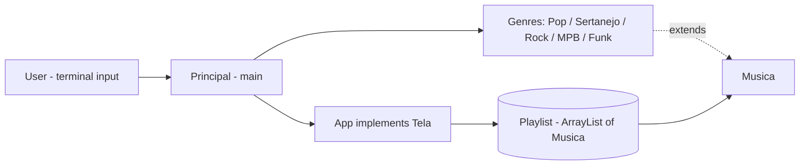

# 🎵 Music App (Java OOP)

[](https://github.com/rafauto/music-app/actions/workflows/ci.yml)


A command-line music player built as the final project of an elective **Object-Oriented Programming (Java)** course at university. It simulates a music app with a playlist, playback state, volume and music genres.

> The source code, comments and console messages are kept in **Portuguese**, exactly as submitted for the course.

## Why I built this

The goal of the assignment was to apply the core OOP concepts in a small, working product: modelling a real-world app (a music player) as classes, contracts and behaviours.

## Features

- Open the app, start playback and show a menu with status (on/playing), a volume bar and the current song
- Pre-loaded playlist with 3 sample songs
- Add a song (name + artist) to the playlist
- Remove a song by name or artist
- Search a song by name or artist
- List music genres (Pop, Sertanejo, Rock, MPB, Funk) using polymorphism
- Volume up/down, play/pause, next/previous and shuffle (implemented in `App`, not wired to the main flow)

## OOP concepts applied

| Concept | Where |
| --- | --- |
| Interface / abstraction | `Tela` declares the app's operations; `App` implements them |
| Encapsulation | Private attributes with getters/setters in `App` and `Musica` |
| Inheritance | `Pop`, `Sertanejo`, `Rock`, `MPB` and `Funk` extend `Musica` |
| Polymorphism | `Principal.categMusica()` calls `categoria()` on each genre |
| Collections | `ArrayList<Musica>` for the playlist, `Collections.shuffle` for shuffle |

## How it works



`Principal` creates the app, opens it, starts playback and shows the menu. It then prints the genre list through polymorphism and runs three interactive steps in sequence: **add**, **remove** and **search** a song. All data lives in memory while the program runs.

## Project structure

```
music-app/
├── src/TrabalhoFinal/
│   ├── Principal.java    # entry point (main)
│   ├── Tela.java         # interface with the app operations
│   ├── App.java          # app logic: state, playlist, menu, add/remove/search
│   ├── Musica.java       # base class (song name + artist)
│   └── Pop, Sertanejo, Rock, MPB, Funk.java   # genre subclasses
├── .github/workflows/ci.yml
├── LICENSE
└── README.md
```

## Getting started

Requirements: **JDK 17 or later**.

```bash
git clone https://github.com/rafauto/music-app.git
cd music-app
javac -encoding UTF-8 -d out src/TrabalhoFinal/*.java
java -cp out TrabalhoFinal.Principal
```

## Usage

The program asks three questions in order. Answer `1` (yes) or `2` (no), then type the song or artist name:

1. Add a song → name and artist
2. Remove a song → name or artist
3. Search a song → name or artist

Non-interactive run (same input the CI uses):

```bash
printf '1\nMusica3\nCantor3\n2\n2\n' | java -cp out TrabalhoFinal.Principal
```

## Continuous integration

GitHub Actions compiles the project on Java 17 and 21 and runs a smoke test that feeds scripted input to the app.

## Known limitations

This is the code as submitted for the course; these issues are documented, not fixed:

- **Search removes the song it finds** (`busca()` calls `musicas.remove`).
- **Remove may report "not found" after a successful removal**, because the result message is overwritten on each loop iteration.
- Genre subclasses pass `null` to the parent constructor, so a genre object never keeps its name and artist.
- `abrirMenu()` re-adds the sample songs each time it is called.
- Volume, next/previous, pause and shuffle are not reachable from the main flow; data is not saved between runs.

## License

[MIT](LICENSE)

## Author

**Rafaela Uto** · [GitHub](https://github.com/rafauto)
